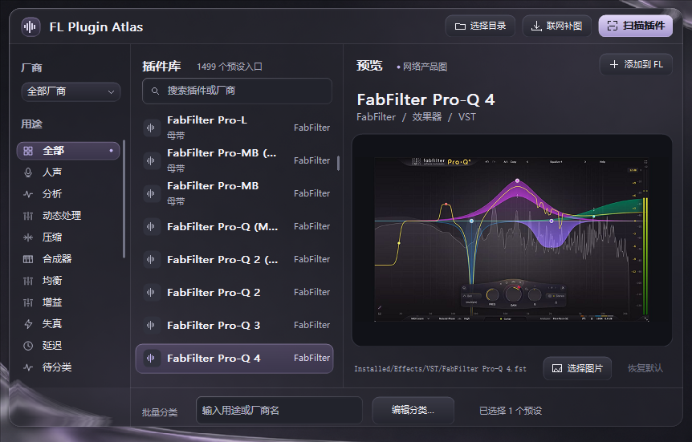

# FL Plugin Atlas

面向 Windows 版 FL Studio 的插件分类管理器。按厂商、用途和关键词查找本地插件，查看产品预览，并将选中的预设添加到 Channel Rack 或 Mixer。

[下载 Windows 安装包](https://github.com/RainDp/FL-Plugin-Atlas/releases/latest) · [报告问题](https://github.com/RainDp/FL-Plugin-Atlas/issues)



## 安装

适用于 Windows 10 / 11 x64，以及支持 CLAP 的 FL Studio。主版本已在 FL Studio 2026 中验证。

1. 从 [Releases](https://github.com/RainDp/FL-Plugin-Atlas/releases) 下载 `FL-Plugin-Atlas-0.1.0-Windows-x64-Setup.exe`。
2. 关闭 FL Studio，运行安装包，并允许 Windows 的管理员确认。
3. 打开 FL Studio，在 **Options → Manage plugins** 中运行 **Find installed plugins**。
4. 在 Mixer 空效果插槽中选择 **More plugins → FL Plugin Atlas**。
5. 点击“扫描插件”读取默认 Plugin database，或用“选择目录”指定自己的目录。

安装包包含 CLAP 插件、`atlas.exe` 命令行工具、使用说明和许可证。插件安装到系统 `Common Files\CLAP`，工具与文档安装到向导选择的目录。开始菜单提供使用说明和卸载入口。FL 的插件目录规则见官方安装手册。[FL Studio 插件安装手册](https://www.image-line.com/fl-studio-learning/fl-studio-online-manual/html/basics_externalplugins.htm)

发布包提供 `SHA256SUMS.txt`。当前安装包为未签名构建。可在 PowerShell 中计算下载文件的 SHA-256，并与校验文件比对。

```powershell
Get-FileHash .\FL-Plugin-Atlas-0.1.0-Windows-x64-Setup.exe -Algorithm SHA256
```

## 浏览和分类

- 厂商采用单选，下拉框中的“全部厂商”用于跨厂商浏览。
- 左侧用途采用单选，点击“全部”可查看当前厂商的全部用途。一个插件可以拥有多个用途标签。
- 列表上方支持按插件名或厂商搜索，搜索会与厂商、用途筛选共同生效。
- 筛选摘要显示当前厂商和用途；“重置筛选”同时恢复全部厂商、全部用途并清空搜索。搜索框的清空按钮及 Esc 只清空关键词。
- Ctrl+F 聚焦搜索，搜索框内按 ↓ 进入结果列表。用途右侧显示当前厂商与搜索条件下的预设数；多用途预设可计入多个用途。
- 预览区显示用途标签；悬停名称或路径可查看完整内容。没有图片时可选择本地图片或使用“联网补图”。
- 在列表中多选预设，在底部输入用途或厂商名称，再打开“编辑分类…”进行批量编辑。
- 分类修改保存在当前用户的 SQLite 目录中，可供多个插件实例共享，重扫后保留人工编辑。

## 添加到 FL

选中一个预设，点击预览上方的“添加到 FL”，松开鼠标，再点击 Channel Rack 空白处（乐器）或 Mixer 空效果插槽（效果器）。按 Esc 或右键取消。

管理器把原始 `.fst` 交给 FL 的接收位置。插件自身作为立体声效果器透传输入，目录扫描在后台运行。

## 预览图片

预览优先使用自选图片，其次使用 FL 缩略图和已缓存的网络产品图。可以通过“选择图片”指定本地 PNG、JPEG 或 BMP。

扫描完成后会自动按厂商和插件名称查询 plugin.watch 的产品图，也可点击“联网补图”重试。查询参数包含厂商和插件名。图片服务可据此判断所查询的产品。本地预设路径和工程内容不属于图片查询参数。

## 数据、升级和卸载

分类数据库位于 `%LOCALAPPDATA%\FL Plugin Atlas\catalog.sqlite3`，网络图片缓存位于同一目录下的 `Online images`。默认扫描目录为 Windows“文档”中的 `Image-Line\FL Studio\Presets\Plugin database`。

升级时先关闭 FL Studio，再运行新版安装包。可在 Windows“已安装的应用”中卸载 FL Plugin Atlas。分类数据和图片缓存保留在用户数据目录，重新安装后可继续使用。

## 命令行

在安装目录打开 PowerShell。

```powershell
.\atlas.exe --help
.\atlas.exe scan
.\atlas.exe vendors
.\atlas.exe purposes
.\atlas.exe list --vendor FabFilter --tag 均衡
.\atlas.exe tag --entry "Installed/Effects/VST3/FabFilter Pro-Q.fst" --add 母带
```

通过 `--library "Plugin database 的完整路径"` 使用自定义目录，通过 `--db` 指定数据库。重复传入 `--entry` 可以批量编辑，重复传入 `--tag` 要求同时满足所有指定用途。`--remove` 可以排除自动标签，`vendor` 用于修正厂商，`alias` 用于合并厂商别名。

## 从源码构建

需要 Visual Studio 2022 的 C++ 桌面工具、含 WinSQLite 的 Windows 10 / 11 SDK，以及 CMake 3.18 或更高版本。

```powershell
cmake -S . -B build -A x64
cmake --build build --config Release
ctest --test-dir build -C Release --output-on-failure
```

首次配置会获取固定版本的 CLAP SDK。离线构建可通过 `-DCLAP_SDK_DIR=已有SDK目录` 指定头文件。Release 输出包含 `FL Plugin Atlas.clap` 和 `atlas.exe`。

安装 Inno Setup 6.3 或更高版本后，可生成同款安装包与 SHA-256 校验文件。

```powershell
.\packaging\build.ps1 -BuildDir .\build\Release
```

也可用 `-IsccPath` 指定 `ISCC.exe`。输出位于 `build/installer`。

Studio 独立界面的源码位于 [versions/Atlas-Studio](versions/Atlas-Studio)。当前主版本支持浏览、分类和直接添加预设，收藏目录发布与撤销仍在规划中。

## 许可证

项目采用 [MIT License](LICENSE)。安装包随附所用运行库的版权声明。
